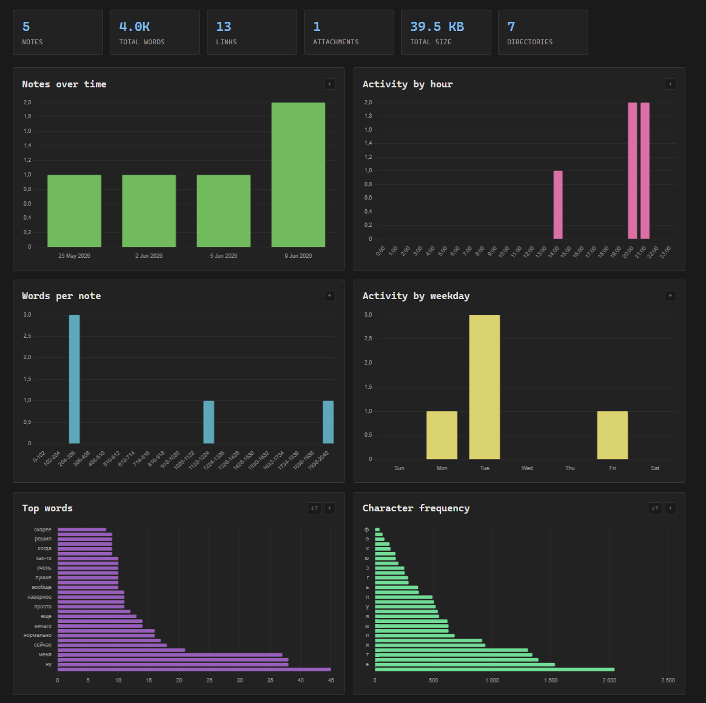

# ObGoData

Analyzes an Obsidian vault and opens a browser dashboard with interactive charts.



## Usage

```powershell
go run . -vault "D:\path\to\vault" -port 9990
```

## Charts

- Notes over time, activity by hour/weekday
- Top words, character frequency, lemma frequency (Snowball stemmer)
- File/folder size distribution
- Link & attachment type breakdown
- Largest notes table

Fullscreen any chart for drag-to-zoom, scroll-zoom, and all data (no limit).
